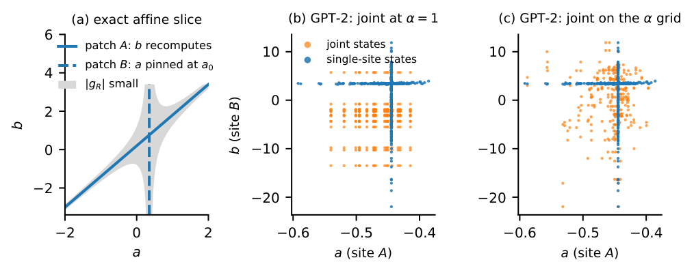
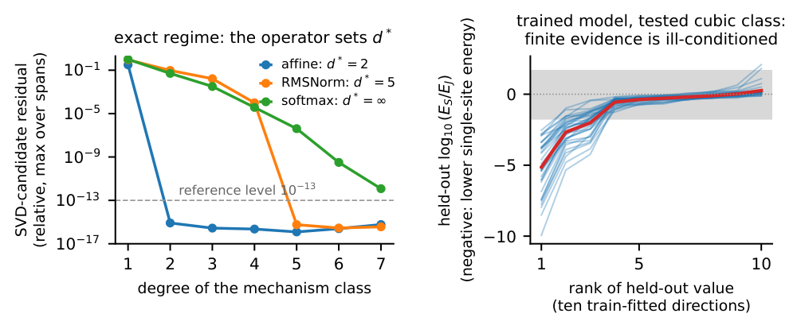
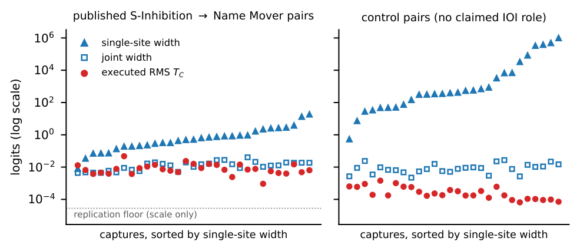

# What Can Activation Patching Actually Establish?

### Reachable-State Geometry and the Limits of Mechanistic Evidence

**Ankush Kadu · Ananth Kalyanasundaram · Aswanth Krishnan**  
QpiAI, India · Accepted poster, **NeurIPS 2026 Workshop TAE (Trust-AI-Eval)** · Non-archival workshop

[Camera-ready paper](paper/main.pdf) · [OpenReview](https://openreview.net/forum?id=Gfh4EJoWTV) · [Reproduce the results](#reproduce-the-results) · [Citation](#citation)

A strong, repeatable patching effect need not uniquely identify a mechanism. **Which competing explanations could the experiment actually distinguish?** We answer this question through the geometry of the internal states reached by an intervention, then examine whether a measured effect carries over to different upstream states on a published IOI circuit.

## Why this matters

Observing an effect, distinguishing explanations, and showing that an effect persists in another context require different evidence. This work gives researchers concrete checks for each:

- **Before interpreting an effect:** declare the mechanism class and inspect which internal states the intervention covers.
- **Before comparing interventions:** check their state ranges and whether the coordinates were selected on the same data being evaluated.
- **Before claiming an effect carries over:** execute the missing intervention combinations and measure the change directly.

This is research on the limits and evaluation of patching evidence. It does not introduce a generally superior circuit-discovery algorithm.

## 1. Experiments can miss the differences between explanations



*Left: on the analysed affine slice, two hypotheses can agree everywhere on the single-site arms and differ away from them. Joint patching can reach those missing states. Middle and right: one GPT-2 IOI capture illustrates the geometry and how grid matching changes the joint family's range. The trained-model arms illustrate weak identification, not exact vanishing. Matching the interpolation grid does not establish equality of the full supports.*

The **blind space** contains hypothesis differences that vanish on every state an intervention family reaches. It is defined relative to a declared mechanism class and chart. On the affine slice,

$$g_R(a,b)=(a-a_0)(b-ma-c)$$

vanishes on both single-site arms. More observations on those arms cannot distinguish hypotheses that differ by this function. The network-produced states determine this limit without a readout.

## 2. Exact blindness differs from weak identification



*Left: numerical illustrations accompany the proved slice results. The dashed line is a reference level of 10⁻¹³; residual decay alone cannot establish transcendence. Right: both tested cubic designs are full rank, yet some directions have much less held-out energy under single-site interventions. Thin lines separately sort each capture's held-out values; the thick line averages these ordered profiles.*

| Question | Finding | Scope |
|---|---|---|
| When does exact blindness begin? | Polynomial onset degree **2** for affine slices, **5** for the stated normalisation slices, and **no finite onset** for the analysed nondegenerate transcendental slices. | Proved for the stated operator slices and coordinates, not entire trained transformers. |
| Can geometry name a weak direction without fitting readouts? | At least **10× less held-out energy** under single-site than joint patching in **171/185 captures**, across 10 model–task cells. | Re-analysis of previously inspected captures; captures share prompts and tasks. |
| How much does a classical baseline explain? | The one-at-a-time generator meets the same threshold in **144/185 captures**. | Scored on the same recompute single-site and joint states; it explains much of the observed weakness. |
| What distorts comparisons? | Unmatched state ranges and chart selection on scored states invalidated two comparisons. | The affected claims are withdrawn in the paper. |

Energy ratios describe how the designs constrain hypothesis differences. They are not observed prediction errors or evidence that a component has a particular semantic role.

## 3. Measure whether an effect carries over



*Exploratory analysis on three base prompts. Triangles and open squares are single-site and joint identification widths under a misspecified cubic working model; circles are the RMS of the executed four-point contrast on each capture's tested grid. The widths are neither observed errors nor calibrated bounds. The dotted line is a scale reference from the separate replication. The exploratory control captures did not measure their numerical floor; this plot supports no above-control conclusion.*

The transport contrast measures how much the downstream head's effect changes when the upstream head changes:

$$T_C(u,v)=Y(u,v)-Y(u,0)-Y(0,v)+Y(0,0).$$

Here `0` denotes the site's clean output, and each corner forces the downstream head's output. Single-site patching generally does not execute all four corners, so it cannot determine this contrast without additional assumptions.

On the exploratory tested grids, the median capture RMS is **0.427% of the capture's downstream-only readout range**, over three base prompts. A preregistered replication used **24 fresh prompts from 8 templates**. Template medians met both registered smallness criteria in **8/8 templates**. The published/control comparison was **floor-limited** because most control contrasts were unresolved above the float32 numerical floor. There is no published/control ratio or above-control finding.

This output-forcing experiment does **not** test the query-mediated pathway identified by Wang et al. or contradict their IOI circuit. Smallness concerns the stated tested-grid summaries, not every intervention state.

## Reproduce the results

Stored captures, analysis code, the claim ledger, preregistration and manuscript sources are included. **No GPU or model download is needed to verify stored results.**

### Install

The recorded verification environment used Python **3.13.5**. Use Python 3.13 and Git. Rebuilding the paper also requires `pdflatex`, `bibtex`, `pdftotext`, and the manuscript's TeX packages.

```bash
git clone https://github.com/Ankush-kadu/activation-patching-identifiability.git
cd activation-patching-identifiability
python3.13 -m venv .venv
source .venv/bin/activate
python -m pip install -r requirements-reproduce.txt
```

`requirements-reproduce.txt` pins the installed Transformers source commit and includes plotting dependencies. The historical `requirements.txt` is unchanged. Shared modules import PyTorch and Transformers even during CPU analysis. Installation needs network access; verification runs offline. We checked the recorded environment, not a fresh dependency installation on every platform.

### Verify

```bash
# Standard-library-only integrity check.
python verify_release.py

# Re-derive claims, test, reproduce the registered analysis in temporary storage,
# and rebuild the paper in an isolated copy.
python verify_release.py --full
```

The full check re-derives **1,190 numerical ledger entries**, runs the released regression tests, compares the replication analysis with its archived output byte for byte, and compares rebuilt manuscript text. It never overwrites frozen analyses or collects new responses. Reproducible calculations do not by themselves establish scientific interpretation.

Individual commands:

```bash
python ledger_paperA.py --verify
python -m pytest -q e0/test_attribution_adequacy.py e0/test_heldout_semantics.py
(cd paper && E0_DIR=../e0 MPLCONFIGDIR=/tmp/patching-mpl bash build.sh)
```

**Fresh collection:** `e0/replicate_transport.py` requires a GPU and GPT-2 small weights. Its original output paths and model-loading assumptions are preserved. Configure a new output location before running it; never overwrite the archived replication. Fresh collection is a new experiment, not part of verification.

## Repository guide

| Path | Contents |
|---|---|
| [`paper/main.pdf`](paper/main.pdf) | Corrected TAE camera-ready manuscript |
| [`paper/`](paper/) | LaTeX, bibliography, vector figures and plotting code |
| [`e0/`](e0/) | Frozen analysis/collection scripts, captures and derived artifacts |
| [`claims_paperA.json`](claims_paperA.json) | Numerical values, units, aggregation and source hashes |
| [`ledger_paperA.py`](ledger_paperA.py) | Re-derives claims; `--verify` checks without rewriting outputs |
| [`prereg/`](prereg/) | Frozen protocol, prompt pool and provenance hashes |
| [`replication/`](replication/) | 576 fresh captures, pilot report and registered analysis |
| [`CORRECTIONS_LEDGER.md`](CORRECTIONS_LEDGER.md) | 57 documented corrections to the reviewed version |
| [`MANIFEST.sha256`](MANIFEST.sha256) | Unchanged original snapshot manifest |
| [`RELEASE_MANIFEST.sha256`](RELEASE_MANIFEST.sha256) | Integrity manifest for this publication package |
| [`verify_release.py`](verify_release.py) | Portable verification entry point |
| [`tools/`](tools/) | Archived maintainer tools; some retain original workspace paths |

## Research transparency

The camera-ready corrects errors found after acceptance and records the resulting withdrawals. Appendix A and the correction ledger explain the changes. Proved slice results, empirical re-analysis, exploratory findings and registered replication outcomes are distinguished throughout. The floor-limited control result remains as registered.

As disclosed in the paper, large language models assisted with code, protocol drafting, algebraic checking, review, writing and literature search. Measurements come from executed interventions and analysis of stored artifacts. The authors take responsibility for the content.

## Citation

Please cite the paper and record the repository revision used. [`CITATION.cff`](CITATION.cff) supplies GitHub citation metadata.

```bibtex
@inproceedings{kadu2026activationpatching,
  title     = {What Can Activation Patching Actually Establish?
               Reachable-State Geometry and the Limits of Mechanistic Evidence},
  author    = {Kadu, Ankush and Kalyanasundaram, Ananth and Krishnan, Aswanth},
  booktitle = {NeurIPS 2026 Workshop TAE (Trust-AI-Eval): Can We Trust AI Evaluation?},
  year      = {2026},
  url       = {https://openreview.net/forum?id=Gfh4EJoWTV},
  note      = {Accepted poster; non-archival workshop}
}
```

## Attribution and reuse

Hosted on Ankush Kadu's personal GitHub account. The research is jointly authored by Ankush Kadu, Ananth Kalyanasundaram and Aswanth Krishnan, with QpiAI affiliation as listed in the paper. Hosting does not change that attribution or establish individual ownership.

No new software or data license is granted by this release; see [`RIGHTS.md`](RIGHTS.md). Existing third-party notices remain applicable. For reproducibility questions or corrections, open an issue identifying the file, revision and observed behavior.
